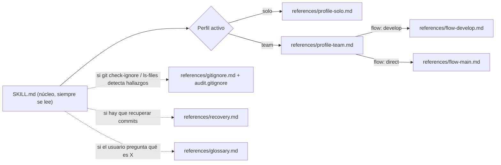
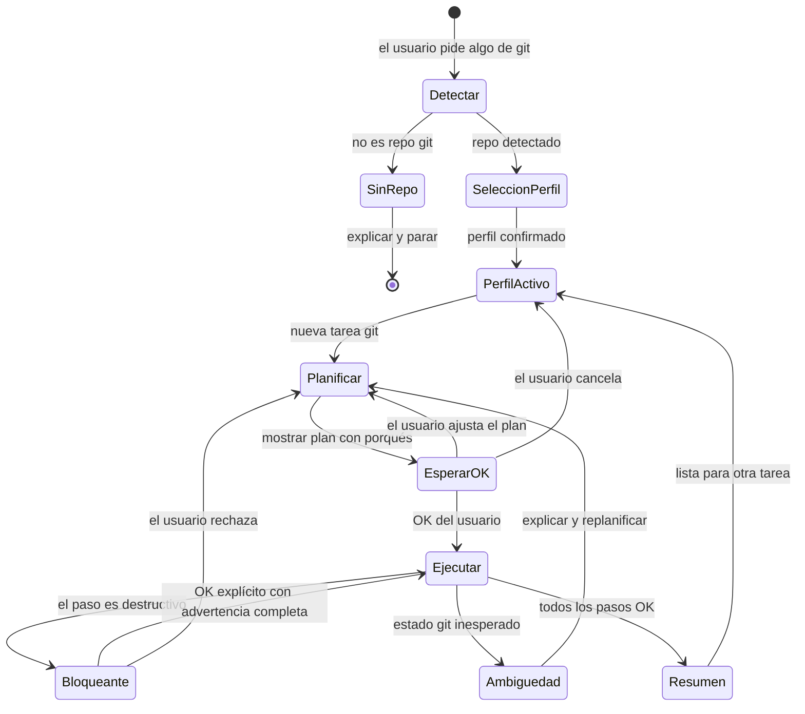
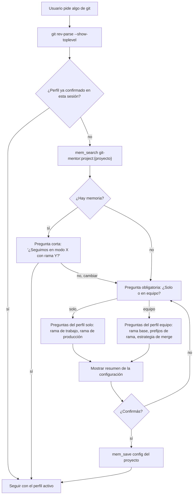
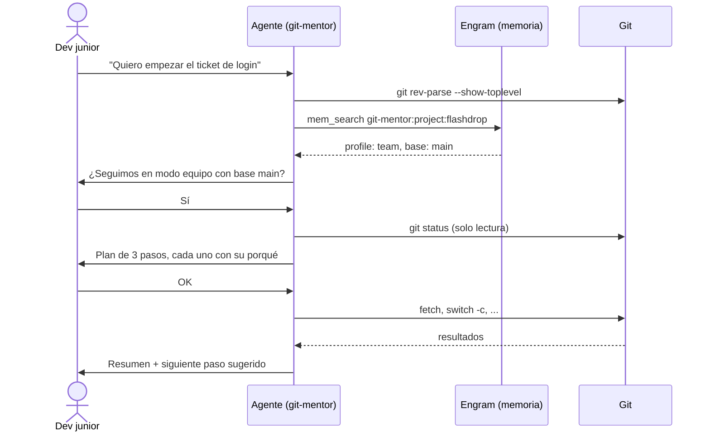
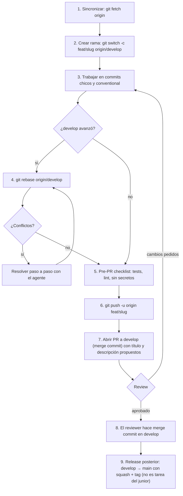

# Diseño: git-mentor v2 (perfiles solo + equipo)

> Estado: **diseño aprobado e implementado** (decisiones D1-D5 cerradas el 2026-11-13).
> Implementado en: `D:\desarrollo\skills\git-mentor\`.
> Skill original sin modificar en: `C:\Users\ASUS TUF F15 i5\.agents\skills\git-mentor\SKILL.md`.

## 1. Objetivo

Enriquecer `git-mentor`, sin reemplazarla, para que:

1. **Antes de cualquier operación git, el agente pregunte con qué tipo de proyecto se va a trabajar** (solo o equipo) y active el modo que corresponde.
2. **En todos los perfiles**, antes de actuar, el agente muestre **el plan de pasos**, cada uno con **una sola frase de por qué**.
3. El perfil de equipo sirva como **guía de trabajo para devs juniors** en un repo compartido.

### No-objetivos

- No se cambia el comportamiento de fondo de `solo-freelancer` (ramas, merge commit, anti-huérfanos).
- No se automatizan merges a producción ni la aprobación de PRs.
- No se definen reglas específicas de FlashDrop dentro de la skill: las particularidades de cada repo van en la memoria del proyecto.

---

## 2. Estructura de archivos

Con dos perfiles completos, la skill se divide en **núcleo + referencias por perfil**, con carga bajo demanda para ahorrar tokens (D1):

```text
D:\desarrollo\skills\git-mentor\
├── SKILL.md                     # núcleo: activación, selección de perfil y flujo, formato de plan,
│                                #   guardia determinista de .gitignore, acciones bloqueantes, reglas de oro
├── DESIGN.md                    # este documento de diseño
└── references/
    ├── audit.gitignore          # diccionario estático de patrones prohibidos/basura para git check-ignore y ls-files
    ├── gitignore.md             # bloques base por stack, porqués didácticos y flujo de plan para .gitignore
    ├── profile-solo.md          # contenido de solo-freelancer + anti-huérfanos + PR solo
    ├── profile-team.md          # reglas comunes del modo equipo (juniors)
    ├── flow-develop.md          # flujo con rama develop (PRs a develop, release a main)
    ├── flow-main.md             # flujo directo a main (PRs a main)
    ├── recovery.md              # recuperación de huérfanos
    └── glossary.md              # glosario didáctico
```



---

## 3. Funcionamiento general

### 3.1 Ciclo de vida de una sesión



### 3.2 Selección de perfil

Regla: **la skill no ejecuta ningún comando git, salvo los de detección de solo lectura, hasta tener un perfil confirmado en la sesión actual.**

**Cuándo el perfil cuenta como confirmado en la sesión** (no se vuelve a preguntar):

- El usuario ya respondió la pregunta solo/equipo o la confirmación corta en esta sesión.
- El usuario ya dijo explícitamente en la conversación el tipo de proyecto ("es un proyecto de equipo", "trabajo solo en esto"), aunque haya sido antes de que se activara la skill.

Si lo dicho en la conversación contradice la memoria del proyecto, gana lo que dijo el usuario y se pregunta si actualizar la memoria.



### 3.3 Formato de interacción: plan + porqué (todos los perfiles)

Antes de ejecutar cualquier tarea git (aunque sea de un solo paso), el agente muestra:

```text
Tarea: <qué pidió el usuario, en una línea>
Perfil: <solo | team> · Rama actual: <rama>

Plan:
1. git fetch origin
   → Para trabajar sobre la última versión de main.
2. git switch -c feat/login-form origin/main
   → Así tu cambio queda aislado del trabajo de los demás.
3. git add src/login/ && git commit -m "feat(auth): add login form validation"
   → Un commit por unidad lógica facilita la revisión.

¿Ejecuto el plan?
```

Reglas del formato:

| Regla | Detalle |
|---|---|
| Una frase por paso | El porqué entra en una línea. Si necesita más, el paso está mal dividido. |
| Comando exacto | Se muestra el comando real que se va a ejecutar, nunca uno aproximado. |
| Un OK por plan | El usuario aprueba el plan entero, no cada paso. Si el plan cambia durante la ejecución, se para y se replanifica. |
| Detalle bajo demanda | Si el usuario pregunta "¿por qué?" o "¿qué es X?", se expande con el glosario. |
| Excepción destructiva | Un paso de la lista bloqueante **no** se aprueba con el OK del plan: se pide confirmación aparte con la advertencia completa. |
| Solo lectura | `status`, `log`, `diff` se pueden ejecutar sin OK, pero se anuncian con su frase de porqué. |
| Resumen final | Al terminar: qué se hizo, en qué estado quedó el repo y cuál es el siguiente paso sugerido. |

### 3.4 Secuencia de una tarea típica



### 3.5 Guardia determinista de `.gitignore` (D7)

Cada vez que el agente ejecuta `git status` o prepara un `git commit`, evalúa el estado de exclusión de archivos mediante el motor nativo en C de Git contra el diccionario estático `references/audit.gitignore` (cero dependencias externas, 100% multiplataforma):

```bash
# 1. Untracked sospechosos en disco según el diccionario estático (sin pipe, multiplataforma)
git ls-files --others --ignored --exclude-from="<skill>/references/audit.gitignore" --directory

# 2. Archivos ya trackeados en el índice que violan .gitignore o audit.gitignore
git ls-files --cached --ignored --exclude-standard --exclude-from="<skill>/references/audit.gitignore"

# 3. Solo si (1) devolvió rutas y existe .gitignore: filtrar cuáles siguen expuestas (líneas que empiezan con `::`)
git check-ignore -n -v -- <rutas-de-1>
```

- **Carga bajo demanda**: si ambos comandos devuelven vacío y existe `.gitignore` en la raíz del repositorio, no se carga `references/gitignore.md`. Solo ante hallazgos (o ausencia de `.gitignore` cuando hay archivos para ignorar) el agente lee `references/gitignore.md`.
- **Alcance híbrido**:
  - **Sin `.gitignore` en el repo**: detecta el stack por archivos marcadores en la raíz (`package.json`, `tsconfig.json`, `pyproject.toml`, `*.csproj`, `go.mod`, `Cargo.toml`) y propone crear `.gitignore` combinando los bloques literales `Base (OS + IDE + Secretos)` + `Stack detectado` + patrones detectados.
  - **Con `.gitignore` existente**: agrega quirúrgicamente al final únicamente los patrones reportados por `git check-ignore`.
  - **Archivos ya trackeados (`--cached`)**: incorpora `git rm --cached <archivo>` (o `-r` para directorios) como paso previo dentro del mismo plan actual.
- **Integración en el plan actual**: la creación/actualización de `.gitignore` y el eventual `git rm --cached` se incluyen como primeros pasos del mismo plan que pidió el usuario, sumando `.gitignore` al commit en curso.
- **Alerta de secretos en el historial**: si un archivo detectado en `--cached` pertenece a `# [SECRETS]` y ya figura en commits previos (`git log -1 -- <archivo>`), el agente advierte explícitamente que `git rm --cached` no borra el historial pasado y que la credencial debe rotarse/revocarse de inmediato.

---

## 4. Perfiles

### 4.1 Comparación

| Aspecto | `solo` (sin cambios) | `team` (nuevo) |
|---|---|---|
| Rama de trabajo | `dev` de larga vida | Una rama corta por tarea, sale de `develop` o `main` según el flujo |
| Nombre de rama | No aplica | `feat/<slug>`, `fix/<slug>`, `chore/<slug>` |
| Ramas extra | Prohibidas | Una por tarea; bugs no relacionados van en otra rama |
| Actualizar con la base | Merge | `git rebase origin/<destino>` sobre la propia rama |
| PR | Uno grande `dev → main` al final | Uno por tarea, chico, contra `develop` o `main` |
| Review | El propio usuario (pre-PR audit) | Obligatoria, de otra persona |
| Merge | `--merge` lo hace el usuario | `--squash` (flujo `direct`) o merge commit a `develop` (flujo `develop`) |
| Squash | Prohibido | Es la estrategia de merge hacia `main` |
| Después del merge | `dev` sigue viva | Se borra la rama; en flujo `develop` queda el release pendiente |

### 4.2 Perfil `team`: flujo de trabajo del junior

Al activar el modo `team` se pregunta además el flujo del repositorio (D6). El flujo `develop` agrega la rama de integración y el back-port de hotfix:



En el flujo `direct` el paso 2 usa `origin/main`, el paso 4 usa `origin/main` y el PR apunta a `main` con squash. Ver `references/flow-main.md` y `references/flow-develop.md`.

### 4.3 Excepción controlada: rebase + push de la propia rama (D4)

En `team`, después de `git rebase origin/main` sobre una rama **ya pusheada**, hace falta `git push --force-with-lease`. Se mantiene bloqueante, con esta variante permitida:

- Permitido solo sobre **la propia rama de feature** (`feat/`, `fix/`, `chore/`), nunca sobre `main` ni ramas compartidas.
- Siempre `--force-with-lease`, nunca `--force`.
- Se pide OK aparte con advertencia completa (no entra en el OK del plan).

---

## 5. Memoria del proyecto (formato extendido)

Mismo topic key: `git-mentor:project:{nombre-del-proyecto}`.

```yaml
profile: team                 # solo | team
commit_language: en
# solo
work_branch: dev
production_branch: main
# team (nuevo)
flow: develop                 # develop | direct  (D6)
base_branch: main              # rama de producción
integration_branch: develop    # solo si flow: develop
feature_target: develop       # rama a la que apuntan los PRs de feature
branch_prefixes: [feat/, fix/, chore/]
merge_strategy: squash         # feature -> destino
release_strategy: squash       # develop -> main (solo si flow: develop)
merge_by: reviewer
# común
special_conventions:
  - "no Co-Authored-By"
notes: []
```

---

## 6. Decisiones cerradas

| ID | Decisión | Resolución |
|---|---|---|
| D1 | ¿Dividir en `SKILL.md` + `references/` o mantener un único archivo? | **Decidido (2026-11-13): dividir**, para no gastar tokens cargando el perfil que no se usa. |
| D2 | Si hay memoria del proyecto, ¿se vuelve a preguntar el perfil cada sesión o alcanza con una confirmación corta? | **Decidido (2026-11-13): confirmación en una línea.** Si en la sesión ya se dijo el tipo de proyecto, no se pregunta de nuevo. |
| D3 | ¿La pregunta inicial ofrece solo Solo/Equipo, o también `team-large`? | **Decidido (2026-11-13): solo dos opciones, Solo/Equipo.** `team-large` sigue como placeholder. |
| D4 | En `team`, ¿el junior puede hacer `push --force-with-lease` sobre su propia rama tras rebase? | **Decidido (2026-11-13): sí, con controles** (solo rama propia `feat/`/`fix/`/`chore/`, nunca `main`, nunca `--force`, OK aparte con advertencia completa; ver 4.3). |
| D5 | ¿El agente puede abrir el PR, o solo prepara título y descripción y el junior lo abre? | **Decidido (2026-11-13): el agente lo abre tras confirmación** del título y la descripción; nunca mergea. |
| D6 | ¿El repositorio en modo equipo usa rama `develop` o trabaja directo a `main`? | **Decidido (2026-11-13): se pregunta en la activación**, después de confirmar que es un proyecto de equipo. Opciones: `develop` (PRs a `develop`, release a `main` con squash, back-port de hotfix) o `direct` (PRs directo a `main`). Se persiste como `flow` en la memoria del proyecto. |
| D7 | ¿Cómo asiste la skill con `.gitignore` sin depender de lo que "vea a ojo" cada LLM ni de runtimes externos? | **Decidido (2026-11-14): guardia determinista en `git status` / pre-commit usando el motor nativo de Git (`git ls-files` + `git check-ignore`) contra `references/audit.gitignore` + guía bajo demanda `references/gitignore.md`.** Alcance híbrido (plantilla por stack si no existe `.gitignore`; adición quirúrgica si ya existe) e integración de `.gitignore` + `git rm --cached` dentro del mismo plan actual. |

### 6.1 Flujos disponibles en modo `team` (D6)

| Aspecto | `flow: develop` | `flow: direct` |
|---|---|---|
| PRs de feature apuntan a | `develop` (merge commit) | `main` (squash) |
| Release | `develop` → `main` con squash + tag `vX.Y.Z` | No hay release step |
| Historia granular | En `develop` y en los PRs | Solo en los PRs de GitHub |
| Back-port de hotfix | Obligatorio (`cherry-pick` a `develop`) | No aplica |
| `main` siempre desplegable | Sí, solo recibe releases | Sí, pero llega trabajo más seguido |
| Costo | Una rama y un paso extra, más disciplina de back-port | Menor |
