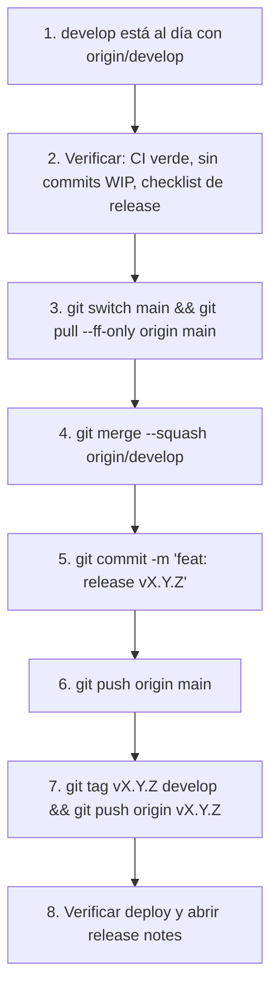
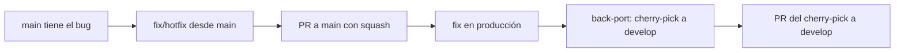

# Flujo `develop` (feature → `develop` → release → `main`)

> Leer solo cuando el proyecto usa `profile: team` con `flow: develop`.
> Las reglas comunes del modo equipo están en `references/profile-team.md`.

## Estructura de ramas

```mermaid
flowchart TD
    M["main (producción)"] <-->|"release PR con squash + tag vX.Y.Z"| D["develop (integración)"]
    D <-->|"PR de feature con merge commit"| F1["feat/xyz"]
    D <-->|"PR de feature con merge commit"| F2["fix/abc"]
    M <-->|"PR de hotfix con squash"| H["fix/hotfix-produccion"]
    H -->|"cherry-pick (back-port)| D
```

- `develop` es la rama de integración: ahí se acumulan los cambios ya revisados.
- `main` es la rama de producción: solo recibe releases.
- La historia granular de cada entrega queda preservada en `develop` (los PRs de feature entran con merge commit) y en los PRs de GitHub.
- El release hacia `main` va con squash, así que `main` muestra **un commit por versión**, no el ruido del trabajo diario.

## Reglas de retención (importante)

1. **`develop` no se borra nunca**: es el archivo histórico real del proyecto.
2. **Cada release se taguea** sobre el tip de `develop`: `git tag v1.2.0 develop` y `git push origin v1.2.0`.
   Ese tag permite consultar el diff y el `blame` de esa versión aunque el squash de `main` haya colapsado los commits.
3. Si alguien borra `develop` después de un release, la historia granular de esa versión se pierde para siempre.

## Flujo de una tarea (dev junior)

1. **Sincronizar**: `git fetch origin`
2. **Crear rama corta desde `origin/develop`**: `git switch -c feat/<short-slug> origin/develop`
3. **Desarrollar en commits chicos y atómicos**: mensajes Conventional Commits.
4. **Actualizar contra `origin/develop` si avanzó**:
   - `git fetch origin`
   - `git rebase origin/develop`
   - Si hay conflictos: frenar y resolver archivo por archivo (`git add <archivo>` → `git rebase --continue`).
5. **Pre-PR checklist**: tests verdes, lint/type-check limpios, working tree limpio, sin secretos.
6. **Subir la rama**:
   - Primera vez: `git push -u origin feat/<short-slug>`
   - Después de un rebase de commits ya subidos: `git push --force-with-lease origin feat/<short-slug>` (con OK bloqueante aparte, D4).
7. **Abrir el PR** contra `develop` (el agente lo abre tras tu confirmación, D5). El reviewer hace **merge commit** (no squash) para preservar la historia granular en `develop`.
8. **Code review**: si piden cambios, nuevos commits en la misma rama y `git push`.
9. El junior **no hace el release**: el release lo ejecuta quien tenga el criterio de release (regla 7 de `profile-team.md`).

## Ejemplo: empezar un ticket

```text
Tarea: Crear la rama para el endpoint de cancelación de órdenes
Perfil: team · Flujo: develop · Rama actual: develop

Plan:
1. git fetch origin
   → Trae el último estado del remoto para no basar tu trabajo en código viejo.
2. git switch -c feat/order-cancellation origin/develop
   → Crea tu rama aislada desde la rama de integración donde se acumulan los cambios revisados.

¿Ejecuto el plan?
```

## Release `develop` → `main` (no es tarea del junior)



**Checklist de release** (antes del paso 4):

- [ ] `develop` está sincronizada con `origin/develop` y su CI está en verde.
- [ ] No hay commits `WIP`, `tmp` ni work-in-progress pendientes.
- [ ] La versión a liberar está acordada (semver o fecha).
- [ ] `main` está al día con `origin/main` (sin divergencia).
- [ ] No hay cambios sin commitear en el working tree.

**Sobre el squash**: `git merge --squash origin/develop` deja los cambios **sin commitear** en `main`; el commit se crea recién en el paso 5, con el mensaje de release. Ese mensaje es la única entrada visible de la versión en `main`, así que debe ser un mensaje de release real (`feat: release v1.2.0`), no el título del último PR.

## Hotfix de producción (con back-port obligatorio)

Este es el punto donde los juniors se traban: con `develop` en el medio, un fix hecho sobre `main` **no vuelve solo a `develop`**.



```bash
# 1. Crear la rama de hotfix desde main
git switch main && git pull --ff-only origin main
git switch -c fix/<short-slug>

# 2. Fix + commit conventional
git commit -m "fix(scope): <qué se corrigió>"

# 3. PR contra main con squash → el reviewer mergea

# 4. Back-port OBLIGATORIO a develop
git switch develop && git pull --ff-only origin develop
git cherry-pick <sha-del-fix>
# (si el cherry-pick choca: git cherry-pick --abort, avisar al usuario y resolver manual)

# 5. PR del cherry-pick contra develop (merge commit) → el reviewer mergea
```

**Regla dura**: si el paso 4 no se completa, el próximo release reintroduce el bug en producción. La skill debe **recordar el back-port** al cerrar el PR de hotfix, y verificar que el fix llegó a `develop` antes de dar el trabajo por terminado.

## Comparación con el flujo `direct`

| Aspecto | `develop` | `direct` |
|---|---|---|
| PRs de feature apuntan a | `develop` (merge commit) | `main` (squash) |
| Release | `develop` → `main` con squash + tag | No hay release step |
| Historia granular | En `develop` y en los PRs | Solo en los PRs de GitHub |
| Back-port de hotfix | Obligatorio (`cherry-pick` a `develop`) | No aplica |
| `main` siempre desplegable | Sí, solo recibe releases | Sí, pero llega trabajo más seguido |
| Costo | Una rama y un paso extra, más disciplina de back-port | Menor |
