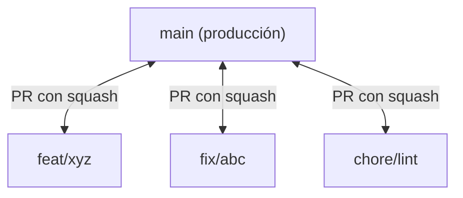

# Flujo `direct` (feature → `main`)

> Leer solo cuando el proyecto usa `profile: team` con `flow: direct`.
> Las reglas comunes del modo equipo están en `references/profile-team.md`.

## Estructura de ramas



- No existe rama de integración.
- Cada PR de feature apunta directo a `main`.
- La historia granular de cada entrega queda en el PR de GitHub (GitHub conserva los commits aunque el merge sea squash) y en los tags del repo.

## Flujo de una tarea

1. **Sincronizar**: `git fetch origin`
2. **Crear rama corta desde `origin/main`**: `git switch -c feat/<short-slug> origin/main`
3. **Desarrollar en commits chicos y atómicos**: mensajes Conventional Commits.
4. **Actualizar contra `origin/main` si avanzó**:
   - `git fetch origin`
   - `git rebase origin/main`
   - Si hay conflictos: frenar y resolver archivo por archivo (`git add <archivo>` → `git rebase --continue`).
5. **Pre-PR checklist**: tests verdes, lint/type-check limpios, working tree limpio, sin secretos.
6. **Subir la rama**:
   - Primera vez: `git push -u origin feat/<short-slug>`
   - Después de un rebase de commits ya subidos: `git push --force-with-lease origin feat/<short-slug>` (con OK bloqueante aparte, D4).
7. **Abrir el PR** contra `main` (el agente lo abre tras tu confirmación, D5).
8. **Code review**: el reviewer aprueba y ejecuta el **squash merge**.
9. **Limpieza**: `git switch main` → `git pull --ff-only origin main` → `git branch -d feat/<short-slug>`.

## Ejemplo: empezar un ticket

```text
Tarea: Crear la rama para el endpoint de cancelación de órdenes
Perfil: team · Flujo: direct · Rama actual: main

Plan:
1. git fetch origin
   → Trae el último estado del remoto para no basar tu trabajo en código viejo.
2. git switch -c feat/order-cancellation origin/main
   → Crea tu rama aislada directamente desde la última versión de main.

¿Ejecuto el plan?
```

## Ejemplo: actualizar una rama ya subida (paso bloqueante D4)

```text
Tarea: Actualizar la rama con los últimos cambios de main después de haber pusheado
Perfil: team · Flujo: direct · Rama actual: feat/order-cancellation

Plan:
1. git fetch origin
   → Descarga los commits nuevos que entraron a main.
2. git rebase origin/main
   → Reaplica tus commits encima del main actual para mantener una historia lineal.
3. [REQUIERE CONFIRMACIÓN APARTE] git push --force-with-lease origin feat/order-cancellation
   → Actualiza tu rama remota tras el rebase verificando que nadie más haya subido commits a ella.

¿Ejecuto los pasos 1 y 2 primero?
```

*(Al llegar al paso 3, el agente frena y presenta la advertencia completa con `ask_user_choice` antes de ejecutar `--force-with-lease`.)*

## Hotfix sobre `main`

En este flujo no hay rama de integración, así que un hotfix de producción **no requiere back-port**:

```bash
git switch main && git pull --ff-only origin main
git switch -c fix/<short-slug>
# fix + commit conventional
# PR contra main con squash, reviewer mergea
# luego: git switch main && git pull --ff-only origin main && git branch -d fix/<short-slug>
```

## Release

No hay release branch: `main` es el estado desplegado y cada merge con squash es una entrega. Si el proyecto versiona releases, se taguea `vX.Y.Z` sobre `main` tras el merge.
